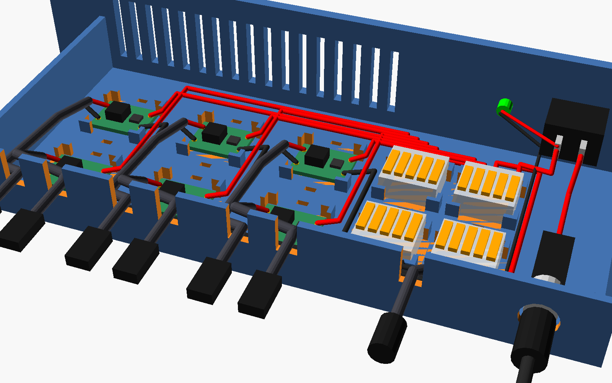
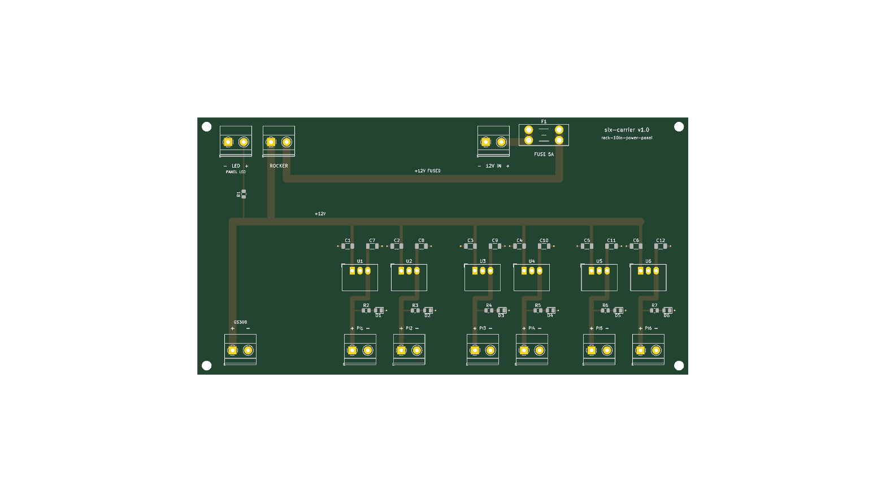
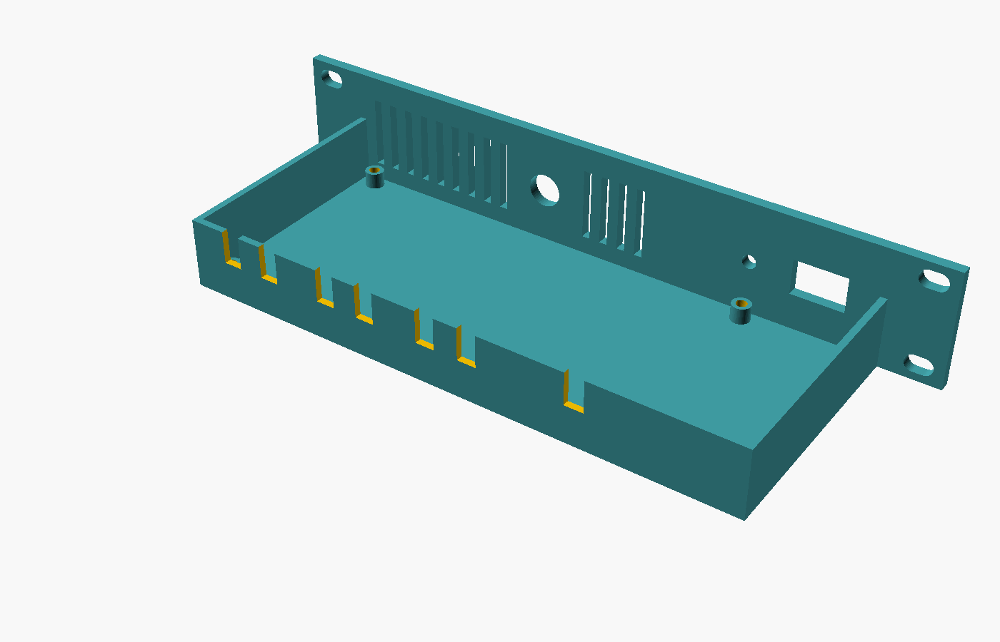
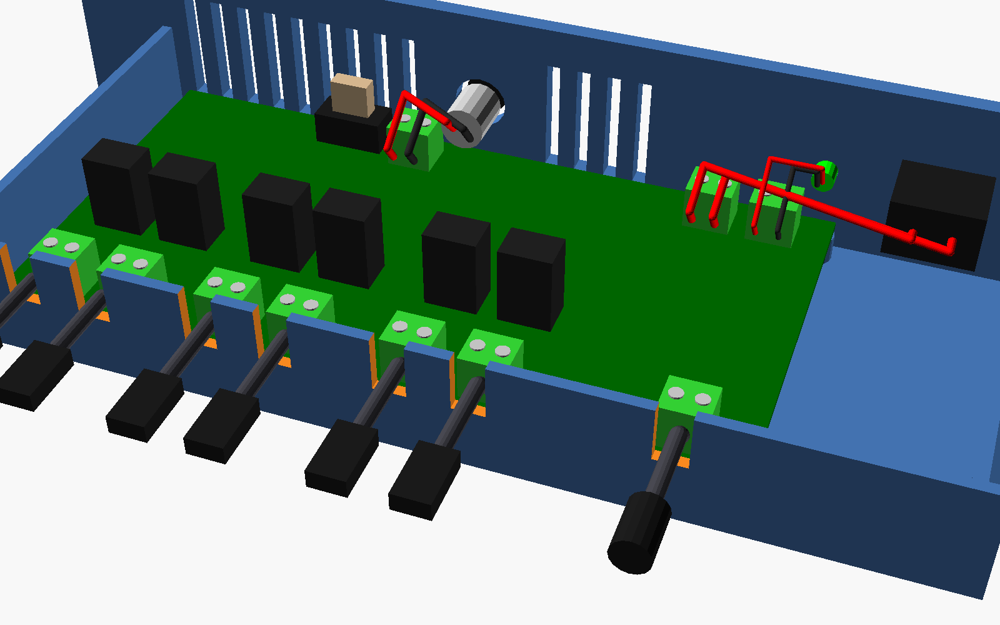
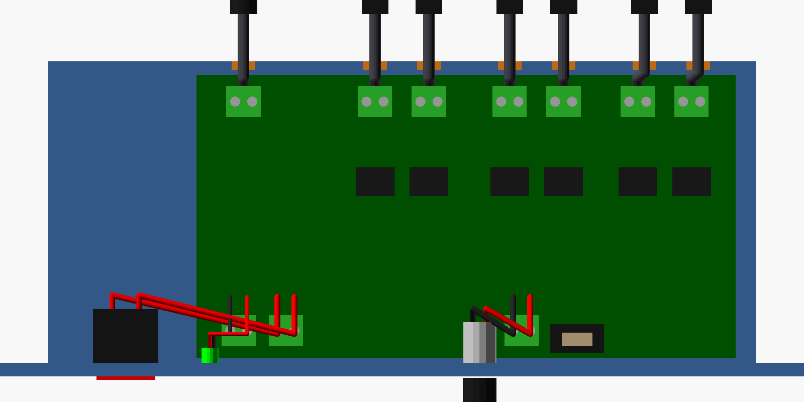
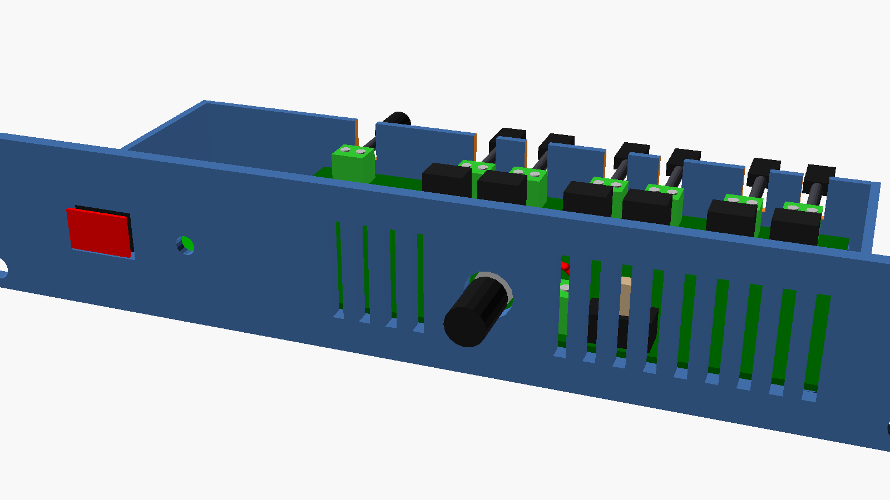

# rack-10in-power-panel

A 3D-printable 1U power panel for a 10" rack. It powers **3× Raspberry Pi 3B+** and a **Netgear GS308** switch from a single 12 V brick. The only mains wiring is the brick's own cord, outside the rack.


## How it works

```
Brick 12V ──► rear DC jack ──► 5A fuse ──► front rocker ──► Wago (+12V / GND)
                                                             ├──► GS308 barrel pigtail (12 V)
                                                             ├──► Buck #1 ──► micro-USB ──► Pi 1
                                                             ├──► Buck #2 ──► micro-USB ──► Pi 2
                                                             └──► Buck #3 ──► micro-USB ──► Pi 3
```

There is one buck converter per Pi, so a fault on one Pi doesn't take down the others.

### Expansion module (Pi 4–6)

A second 1U panel can run off the same brick. Panel 1 taps 12 V after its fuse and rocker and sends it out through an **XT30** pigtail to the expansion panel:

```
Panel 1 Wago ──► 221-413 ──► XT30 link out ──► 18 AWG jumper (<30 cm) ──► XT30 in
                                                                          │
Panel 2: (optional rocker) ──► Wago 221-415 ──► Buck 4–6 ──► Pi 4–6 ◄─────┘
```

- **One 60 W brick handles 6 Pi 3B+ total.** A third panel needs its own brick, or upgrade to a 12 V 7.5 A brick with a 7.5 A fuse.
- The link uses XT30, **not** a 5.5×2.1 barrel. If the brick got plugged into a barrel output by mistake, power would feed in behind the fuse and switch.
- The expansion panel has no fuse of its own: panel 1's 5 A fuse protects the whole chain.
- The GS308 has 7 usable ports, so going past 7 Pis also means adding a second switch.

| Device | Input | Typical draw | Worst case |
|---|---|---|---|
| Pi 3B+ ×3 | 5.1 V micro-USB | ~2–3 W each | ~5–6 W each |
| GS308 | 12 V barrel | ~2–3 W | ~4 W |

### Six-buck panel (Pi 1–6 in one 1U)

All six Pis and the GS308 can also run from **one** panel instead of main + expansion. It has the main module's input (DC jack, 5 A fuse, rocker), no link-out, and the bucks in two rows of three. The DC jack is on the **front panel**, between the LED and the vents, so the brick plugs in from the front:

```
Brick 12V ──► front DC jack ──► 5A fuse ──► rocker ──► Wago 221-415 ══ jumper ══ Wago 221-415   (+12V; GND the same)
                                                        ├──► GS308         ├──► Buck 3–6 ──► Pi 3–6
                                                        └──► Buck 1–2 ──► Pi 1–2
```

- **Wagos:** each rail needs 8 connections (input, GS308, 6 bucks), and a 221-415 has only 5 ports. Use two 221-415s per rail joined by a short jumper, which leaves exactly 8 usable ports. The front pair of pockets is for +12 V, the rear pair for GND.
- **Load:** about 44 W worst case on the 60 W brick (about 3.7 A through the 5 A fuse). That's the same load as main + expansion.
- **Heat:** six bucks lose about 4–5 W in a closed 1U tray. Print in PETG rather than PLA.
- **Trade-off:** it's one print and no XT30 link, but there's no room to grow past 6 Pis without a second brick.


Wired up, with stand-in parts (`cad/six-assembly.scad`, a preview only, not for printing). Red is +12 V, black is GND, grey cables are the micro-USB and GS308 pigtails:




- **Panel LED:** both 221-415 pairs are full, so the LED's + wire piggybacks on the rocker's output tab (1 kΩ resistor in the lead), and its − wire shares GND Wago A's jumper port in a twin ferrule. An illuminated 3-pin rocker avoids the extra wires entirely.

### Six-output carrier PCB (fully assembled)

A 160 × 84 mm, 2-layer board that replaces the bucks, the Wagos and all the internal wiring of the six-buck panel. Every part is a catalogue part, so the fab (e.g. PCBWay) can assemble the whole board, and every off-board wire lands in a screw terminal. There's nothing to solder.



- **Per Pi:** a RECOM **R-78B5.0-2.0** drop-in switching regulator (5 V, 2 A), 10 µF in / 22 µF out ceramic capacitors, a green status LED, and a screw terminal on the rear edge lined up with that Pi's tray notch.
- **Front edge:** each terminal sits behind its panel part, so every lead is short. On the left, `PANEL LED` (2.2 kΩ on board, so use a plain 5 mm LED; **+** is the anode) and `ROCKER` (bridge it if you have no rocker). On the right, `12V IN` (from a pre-wired 5.5×2.1 panel jack) and the 5 A mini blade fuse. The front terminals' wire entries face into the board, so the leads loop over and drop in from behind.
- **Rear edge:** `GS308` (switched 12 V) and `PI1`–`PI6` (5 V). Each terminal is marked **+** and **−**.
- **What you wire:** the panel jack lead, the rocker, the panel LED, the GS308 lead and six micro-USB pigtails, all into screw terminals.
- **Load:** each regulator delivers up to 2 A (a Pi 3B+ needs about 1.3 A worst case without USB drives). The output is a fixed 5.0 V, so keep the pigtails short and 20–22 AWG.
- **Tray:** [`cad/six-pcb-panel.scad`](cad/six-pcb-panel.scad) (`role = "six-pcb"`). Four standoffs with M3 heat-set inserts hold the board, and there are no pockets or zip-tie slots. The front-panel jack sits at x = 150, over the board's empty front-right corner, so it clears the fuse and terminals; the vents skip around it.



Fit check with stand-ins for the tall parts (regulators, terminals, fuse) and the leads ([`cad/six-pcb-assembly.scad`](cad/six-pcb-assembly.scad), a preview only):







- **Heights:** the board sits on 6 mm standoffs; the regulators top out about 27.6 mm above the tray floor, under 1U.

Schematic: [`docs/six-carrier-schematic.pdf`](docs/six-carrier-schematic.pdf). Everything is generated by [`pcb/generate.py`](pcb/generate.py). Edit the script, not the `.kicad_*` files, then run:

```bash
pcb/build.sh
```

It runs ERC and DRC with schematic parity (the build fails on any error and lists every warning), then writes to `pcb/out/`:

| File | For |
|---|---|
| `six-carrier-gerbers.zip` | PCB fabrication (Gerbers + drill) |
| `six-carrier-bom.csv` | Assembly BOM: designators, value, footprint, part number |
| `six-carrier-pos.csv` | Assembly placement, origin at the board's bottom-left corner |
| `six-carrier-schematic.pdf`, `-3d.png`, `-top.svg` | Review |

**Current status (v1.0):** ERC 0 violations; DRC 0 errors, 0 unconnected, 0 parity issues. One cosmetic silkscreen warning (D4's reference touches its own outline). Not yet fabricated or printed. Before ordering, check the R-78B and terminal stock and part numbers in PCBWay's quote. Also check which way the terminals' wire entry faces: the front three are meant to face into the board, the rear seven toward the rear edge.

## Repo layout

| Path | What |
|---|---|
| [`cad/rack-power-panel.scad`](cad/rack-power-panel.scad) | Parametric OpenSCAD model (panel + tray). Main module by default. |
| [`cad/expansion-panel.scad`](cad/expansion-panel.scad) | Expansion module: includes the main model with `role = "expansion"` |
| [`cad/six-panel.scad`](cad/six-panel.scad) | Six-buck panel: all six Pis in one 1U (`role = "six"`) |
| [`cad/six-assembly.scad`](cad/six-assembly.scad) | Six-buck panel with stand-in parts and wiring (preview only) |
| [`cad/six-pcb-panel.scad`](cad/six-pcb-panel.scad) | Panel and tray for the six-output carrier PCB (`role = "six-pcb"`) |
| [`cad/six-pcb-assembly.scad`](cad/six-pcb-assembly.scad) | Carrier board in its tray with stand-in parts and leads (fit check only) |
| [`pcb/`](pcb/) | Six-output carrier PCB, generated by [`pcb/generate.py`](pcb/generate.py) |
| [`cad/render.sh`](cad/render.sh) | Renders every variant to STL + PNG and fails on warnings or a non-manifold mesh |
| [`docs/layout.svg`](docs/layout.svg) | Front and top view with dimensions, drawn to scale |
| [`BOM.md`](BOM.md) | Bill of materials |

## Before printing

The model is parametric. Measure your parts and change the values at the top of the `.scad` file:

1. `ear_pitch` (236.5): your rack's hole spacing, center to center.
2. `buck_in` ([22, 20]): the pocket size for your buck module.
3. `jack_d` (12.2): use 8.2 for an M8-body DC jack. `jack_side` (`"rear"` or `"front"`) puts it in the rear wall or on the front panel at `jack_front_x`. The main panel uses the rear; the six-buck panel sets `"front"` in `six-panel.scad`.
4. `rocker` ([19.4, 13.1]): the cutout for your rocker switch.
5. `tray_w` (210): this must fit between your rack rails.

To export an STL:

```bash
openscad -o rack-power-panel.stl cad/rack-power-panel.scad
```

```bash
openscad -o expansion-panel.stl cad/expansion-panel.scad
```

```bash
openscad -o six-panel.stl cad/six-panel.scad
```

Or render all variants (STL + PNG preview) to `cad/out/` and check them:

```bash
cad/render.sh
```

It finds `openscad` on your PATH or an OpenSCAD AppImage in `~/AppImages` (or set `OPENSCAD=/path/to/openscad`). It fails if OpenSCAD reports a warning, an error or a non-manifold mesh.

All the files share every dimension, so a change in `rack-power-panel.scad` carries over to the other variants. To change just one variant, override the parameter in its wrapper file below the `include`. The six-buck layout has its own parameters (`buck6_x`, `buck6_y`, `wago6_pos`, `pi6_notch_x`).

The drawing in `docs/layout.svg` shows the main module before the link-out was added.

| | Main | Expansion | Six-buck |
|---|---|---|---|
| Input | 5.5×2.1 DC jack (rear wall) | XT30 pigtail through a rear notch | 5.5×2.1 DC jack (front panel) |
| Fuse | 5 A inline, with tie-down | none | 5 A inline, with tie-down |
| Rocker | yes | optional (`expansion_rocker`) | yes |
| Bucks | 3, one row | 3, one row | 6, two rows of three |
| Wago | 221-415 + 221-413 | 221-415 | 4× 221-415 |
| Rear notches | link out, GS308, Pi ×3 | link in, Pi ×3 | GS308, Pi ×6 |
| Strain relief | zip slots at the link-out | zip slots at the link-in | none (no link) |

**Printing:** print with the tray floor on the bed and the front panel standing up, so nothing needs supports. PETG is preferred. If your parts differ from the defaults, print a thin test strip of the front panel first to check the rack holes and the switch cutout.

## Bring-up checklist

1. Power the 12 V bus with nothing connected and check polarity at each Wago output.
2. Measure each buck's output. It should read **5.1–5.2 V**.
3. Check that the GS308 pigtail is **center-positive**.
4. Connect the devices, boot, and run `vcgencmd get_throttled` on each Pi. `0x0` means no under-voltage.

## Status

All three variants render cleanly in OpenSCAD 2021.01 (no warnings, manifold meshes). Nothing has been test-printed yet, so expect to adjust the model after a test print.
