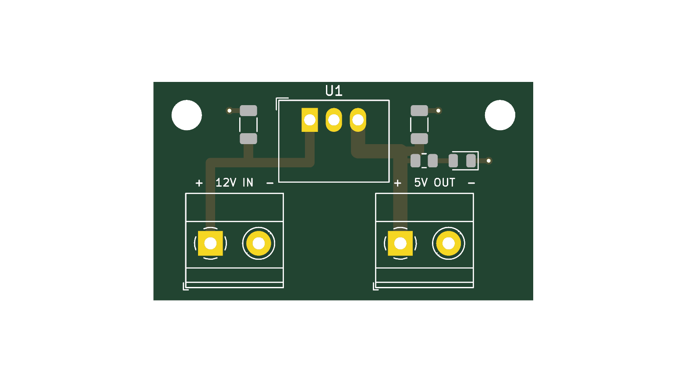

# rack-10in-power-panel

A 3D-printable 1U power panel for a 10" rack. It powers **3× Raspberry Pi 3B+** and a **Netgear GS308** switch from a single 12 V brick. The only mains wiring is the brick's own cord, outside the rack.


## How it works

```
Brick 12V ──► rear DC jack ──► 5A fuse ──► front rocker ──► Wago (+12V / GND)
                                                             ├──► GS308 barrel pigtail (12 V)
                                                             ├──► Buck #1 ──► micro-USB ──► Pi 1
                                                             ├──► Buck #2 ──► micro-USB ──► Pi 2
                                                             └──► Buck #3 ──► micro-USB ──► Pi 3
```

There is one buck converter per Pi, so a fault on one Pi doesn't take down the others.

### Expansion module (Pi 4–6)

A second 1U panel can run off the same brick. Panel 1 taps 12 V after its fuse and rocker and sends it out through an **XT30** pigtail to the expansion panel:

```
Panel 1 Wago ──► 221-413 ──► XT30 link out ──► 18 AWG jumper (<30 cm) ──► XT30 in
                                                                          │
Panel 2: (optional rocker) ──► Wago 221-415 ──► Buck 4–6 ──► Pi 4–6 ◄─────┘
```

- **One 60 W brick handles 6 Pi 3B+ total.** A third panel needs its own brick, or upgrade to a 12 V 7.5 A brick with a 7.5 A fuse.
- The link uses XT30, **not** a 5.5×2.1 barrel. If the brick got plugged into a barrel output by mistake, power would feed in behind the fuse and switch.
- The expansion panel has no fuse of its own: panel 1's 5 A fuse protects the whole chain.
- The GS308 has 7 usable ports, so going past 7 Pis also means adding a second switch.

| Device | Input | Typical draw | Worst case |
|---|---|---|---|
| Pi 3B+ ×3 | 5.1 V micro-USB | ~2–3 W each | ~5–6 W each |
| GS308 | 12 V barrel | ~2–3 W | ~4 W |

### Single-Pi power board (optional)

A 40 × 23 mm board that replaces one bare buck module: one board per Pi. It's a RECOM **R-78B5.0-2.0** (5 V, 2 A) drop-in regulator with input and output capacitors and a green status LED. Every part is a catalogue part, so the fab can assemble it, and both connections are screw terminals: 12 V in from the Wago, 5 V out to the micro-USB pigtail. Order 5 and fit 3 (or 6 with the expansion panel).



- **Terminals:** both on the bottom edge, marked **+** and **−**. Left is `12V IN`, right is `5V OUT`.
- **Mounting:** two M3 holes along the top edge.
- **Output:** a fixed 5.0 V (not adjustable), up to 2 A. That's enough for a Pi 3B+ without USB drives; keep the pigtail short and 20–22 AWG.
- **Fit:** it's about the size of a buck module but taller (the regulator is 17.5 mm high). The tray's buck pockets (`buck_in`) would need to grow to about 42 × 25 mm, which hasn't been done yet.

Schematic: [`docs/pi-power-schematic.pdf`](docs/pi-power-schematic.pdf). Everything is generated by [`pcb/generate.py`](pcb/generate.py); edit the script, not the `.kicad_*` files, then run:

```bash
pcb/build.sh
```

It runs ERC and DRC with schematic parity (the build fails on any error and lists every warning), then writes to `pcb/out/` the files for a PCBWay assembly order: `pi-power-gerbers.zip`, `pi-power-bom.csv` (designators, values, part numbers) and `pi-power-pos.csv` (placement, origin at the board's bottom-left corner), plus a schematic PDF and renders.

**Current status (v1.0):** ERC 0 violations; DRC 0 errors, 0 warnings, 0 unconnected, 0 parity issues. Not yet fabricated. Before ordering, confirm the R-78B and terminal stock and part numbers in PCBWay's quote, and that the terminals' wire entry faces the bottom edge.

## Repo layout

| Path | What |
|---|---|
| [`cad/rack-power-panel.scad`](cad/rack-power-panel.scad) | Parametric OpenSCAD model (panel + tray). Main module by default. |
| [`cad/expansion-panel.scad`](cad/expansion-panel.scad) | Expansion module: includes the main model with `role = "expansion"` |
| [`docs/layout.svg`](docs/layout.svg) | Front and top view with dimensions, drawn to scale |
| [`pcb/`](pcb/) | Single-Pi power board, generated by [`pcb/generate.py`](pcb/generate.py) |
| [`BOM.md`](BOM.md) | Bill of materials |

## Before printing

The model is parametric. Measure your parts and change the values at the top of the `.scad` file:

1. `ear_pitch` (236.5): your rack's hole spacing, center to center.
2. `buck_in` ([22, 20]): the pocket size for your buck module.
3. `jack_d` (12.2): use 8.2 for an M8-body DC jack.
4. `rocker` ([19.4, 13.1]): the cutout for your rocker switch.
5. `tray_w` (210): this must fit between your rack rails.

To export an STL:

```bash
openscad -o rack-power-panel.stl cad/rack-power-panel.scad
```

```bash
openscad -o expansion-panel.stl cad/expansion-panel.scad
```

Both files share every dimension, so a change in `rack-power-panel.scad` carries over to the expansion panel. To change just the expansion panel, override the parameter in `expansion-panel.scad` below the `include`.

The drawing in `docs/layout.svg` shows the main module before the link-out was added.

| | Main | Expansion |
|---|---|---|
| Input | 5.5×2.1 DC jack (rear wall) | XT30 pigtail through a rear notch |
| Fuse | 5 A inline, with tie-down | none |
| Rocker | yes | optional (`expansion_rocker`) |
| Wago | 221-415 + 221-413 | 221-415 |
| Rear notches | link out, GS308, Pi ×3 | link in, Pi ×3 |
| Strain relief | zip slots at the link-out | zip slots at the link-in |

**Printing:** print with the tray floor on the bed and the front panel standing up, so nothing needs supports. PETG is preferred. If your parts differ from the defaults, print a thin test strip of the front panel first to check the rack holes and the switch cutout.

## Bring-up checklist

1. Power the 12 V bus with nothing connected and check polarity at each Wago output.
2. Measure each buck's output. It should read **5.1–5.2 V**.
3. Check that the GS308 pigtail is **center-positive**.
4. Connect the devices, boot, and run `vcgencmd get_throttled` on each Pi. `0x0` means no under-voltage.

## Status

The model has not been test-printed or checked in OpenSCAD yet. Expect to adjust it after a test print.
