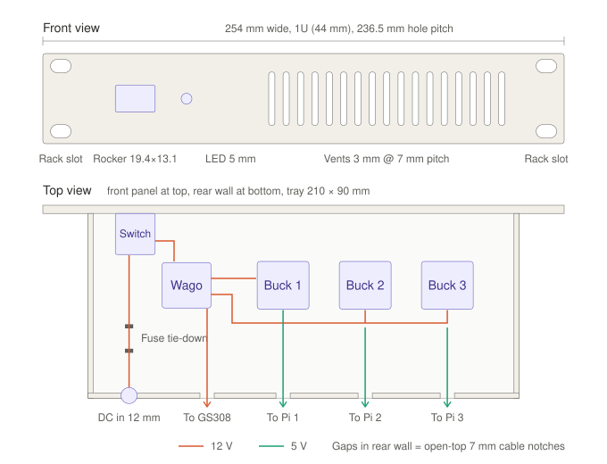
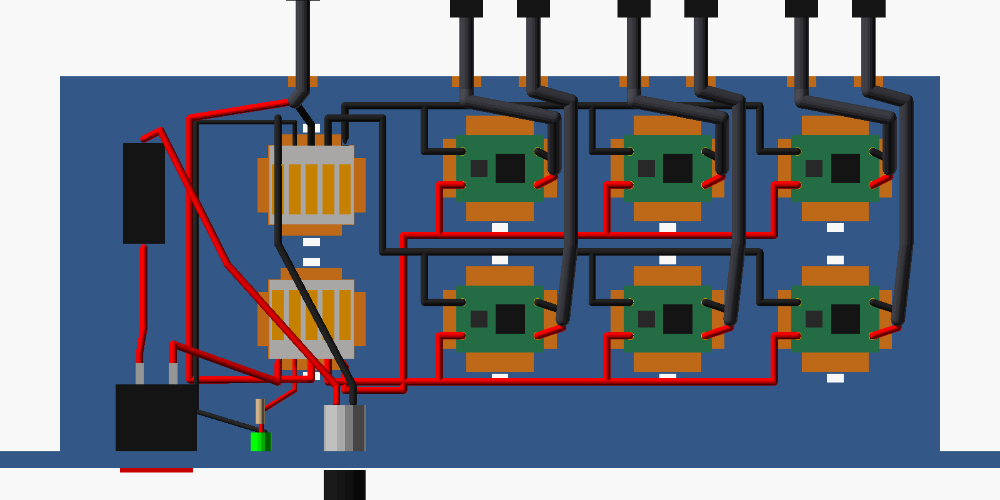
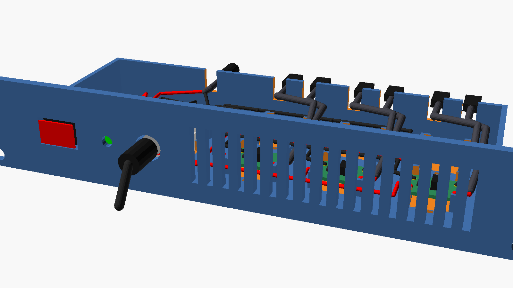

# rack-10in-power-panel

A 3D-printable 1U power panel for a 10" rack. It powers **3× Raspberry Pi 3B+** and a **Netgear GS308** switch from a single 12 V brick. The only mains wiring is the brick's own cord, outside the rack.



## How it works

```
Brick 12V ──► rear DC jack ──► 5A fuse ──► front rocker ──► Wago (+12V / GND)
                                                             ├──► GS308 barrel pigtail (12 V)
                                                             ├──► Buck #1 ──► micro-USB ──► Pi 1
                                                             ├──► Buck #2 ──► micro-USB ──► Pi 2
                                                             └──► Buck #3 ──► micro-USB ──► Pi 3
```

There is one buck converter per Pi, so a fault on one Pi doesn't take down the others. The tray has two 221-415 pockets: the front one is for +12 V and the rear one for GND. Each rail uses exactly 5 ports (input, GS308, 3 bucks).

| Device | Input | Typical draw | Worst case |
|---|---|---|---|
| Pi 3B+ ×3 | 5.1 V micro-USB | ~2–3 W each | ~5–6 W each |
| GS308 | 12 V barrel | ~2–3 W | ~4 W |

### Six-buck panel (Pi 1–6 in one 1U)

All six Pis and the GS308 can also run from **one** panel. It has the main module's input (DC jack, 5 A fuse, rocker) and the bucks in two rows of three. The DC jack is on the **front panel**, between the LED and the vents, so the brick plugs in from the front:

```
Brick 12V ──► front DC jack ──► 5A fuse ──► rocker ──► Wago 221-415   (+12V; GND the same)
                                                        ├──► panel LED (1 kΩ)
                                                        ├──► GS308
                                                        ├──► Buck 1 IN ──► Buck 2 IN ──► Buck 3 IN   (front row, daisy-chained)
                                                        └──► Buck 4 IN ──► Buck 5 IN ──► Buck 6 IN   (rear row, daisy-chained)
                                                             each buck OUT ──► its own micro-USB ──► Pi 1–6
```

- **Wagos:** one 221-415 per rail. The front pocket is for +12 V and the rear pocket for GND. On each, the 5 ports are: input, LED, GS308, front-row chain and rear-row chain.
- **Daisy chain:** each row's 12 V input runs Wago → buck 1 → buck 2 → buck 3 (GND the same), all in 18 AWG. At buck 1 and buck 2, join three wires in a pigtail splice: the wire coming in, the wire going on to the next buck, and a short lead to the buck's input pad. The last buck in each row is wired straight from the trunk. That's 4 splices per row and 8 for the panel. Each pad has one wire and carries only its own buck's current.

  ```
  from Wago / previous buck ──┐
  to next buck ───────────────┼──● splice (closed-end crimp cap, or solder + heat-shrink)
  short lead to Buck IN ──────┘
  ```

  - **Closed-end crimp caps:** use 16–14 AWG nylon caps. Three 18 AWG wires are about 4,900 cmil, more than most 22–16 caps take. Check that the pack's wire-combination chart covers 3×18. Crimp with the closed-end die, not pliers. Make one test splice and tug each wire on its own before doing all eight.
  - **Or solder:** twist the three wires, solder, trim the tips, and cover with adhesive-lined heat-shrink.
  - **Never just twist and heat-shrink.** Without solder or a crimp, the joint loosens and heats up over time.
  - The first link of a row carries all three bucks, about 1.5 A at worst case. That's easy for 18 AWG. A failed splice drops the bucks after it in that row, which is another reason to tug-test. The 5 V side is still one buck per Pi, so a fault on one Pi doesn't affect the others.
- **Load:** about 44 W worst case on the 60 W brick (about 3.7 A through the 5 A fuse).
- **Heat:** six bucks lose about 4–5 W in a closed 1U tray. Print in PETG rather than PLA.
- **Limits:** going past 6 Pis needs a second brick (or a 12 V 7.5 A brick with a 7.5 A fuse). The GS308 has 7 usable ports, so past 7 Pis you also need a second switch.


Wired up, with stand-in parts (`cad/six-assembly.scad`, a preview only, not for printing). Red is +12 V, black is GND, grey cables are the micro-USB and GS308 pigtails:






- **Panel LED:** + to the +12 V Wago's port 1 through a 1 kΩ resistor in the lead, − to the GND Wago's port 1.

## Repo layout

| Path | What |
|---|---|
| [`cad/rack-power-panel.scad`](cad/rack-power-panel.scad) | Parametric OpenSCAD model (panel + tray). Main module by default. |
| [`cad/six-panel.scad`](cad/six-panel.scad) | Six-buck panel: all six Pis in one 1U (`role = "six"`) |
| [`cad/six-assembly.scad`](cad/six-assembly.scad) | Six-buck panel with stand-in parts and wiring (preview only) |
| [`cad/render.sh`](cad/render.sh) | Renders every variant to STL + PNG and fails on warnings or a non-manifold mesh |
| [`docs/layout.svg`](docs/layout.svg) | Front and top view with dimensions, drawn to scale |
| [`BOM.md`](BOM.md) | Bill of materials |

## Before printing

The model is parametric. Measure your parts and change the values at the top of the `.scad` file:

1. `ear_pitch` (236.5): your rack's hole spacing, center to center.
2. `buck_in` ([22, 20]): the pocket size for your buck module. `buck_standoff_h` (3): corner ledges in each buck pocket lift the board this far off the floor, which leaves room for solder pins and lets air flow under it. The zip tie still holds the board down. Set it to 0 to put the board flat on the floor.
3. `jack_d` (12.2): use 8.2 for an M8-body DC jack. `jack_side` (`"rear"` or `"front"`) puts it in the rear wall or on the front panel at `jack_front_x`. The main panel uses the rear; the six-buck panel sets `"front"` in `six-panel.scad`.
4. `rocker` ([19.4, 13.1]): the cutout for your rocker switch.
5. `tray_w` (210): this must fit between your rack rails.

To export an STL:

```bash
openscad -o rack-power-panel.stl cad/rack-power-panel.scad
```

```bash
openscad -o six-panel.stl cad/six-panel.scad
```

Or render all variants (STL + PNG preview) to `cad/out/` and check them:

```bash
cad/render.sh
```

It finds `openscad` on your PATH or an OpenSCAD AppImage in `~/AppImages` (or set `OPENSCAD=/path/to/openscad`). It fails if OpenSCAD reports a warning, an error or a non-manifold mesh.

All the files share every dimension, so a change in `rack-power-panel.scad` carries over to the other variants. To change just one variant, override the parameter in its wrapper file below the `include`. The six-buck layout has its own parameters (`buck6_x`, `buck6_y`, `wago6_pos`, `pi6_notch_x`).

The drawing in `docs/layout.svg` shows the main module with only the +12 V Wago. The model also has a GND Wago pocket behind it.

| | Main | Six-buck |
|---|---|---|
| Input | 5.5×2.1 DC jack (rear wall) | 5.5×2.1 DC jack (front panel) |
| Fuse | 5 A inline, with tie-down | 5 A inline, with tie-down |
| Rocker | yes | yes |
| Bucks | 3, one row | 6, two rows of three |
| Wago | 2× 221-415 | 2× 221-415, bucks daisy-chained in rows |
| Rear notches | GS308, Pi ×3 | GS308, Pi ×6 |

**Printing:** print with the tray floor on the bed and the front panel standing up, so nothing needs supports. PETG is preferred. If your parts differ from the defaults, print a thin test strip of the front panel first to check the rack holes and the switch cutout.

## Bring-up checklist

1. Power the 12 V bus with nothing connected and check polarity at each Wago output.
2. Measure each buck's output. It should read **5.1–5.2 V**.
3. Check that the GS308 pigtail is **center-positive**.
4. Connect the devices, boot, and run `vcgencmd get_throttled` on each Pi. `0x0` means no under-voltage.

## Status

Both variants render cleanly in OpenSCAD 2021.01 (no warnings, manifold meshes). Nothing has been test-printed yet, so expect to adjust the model after a test print.
