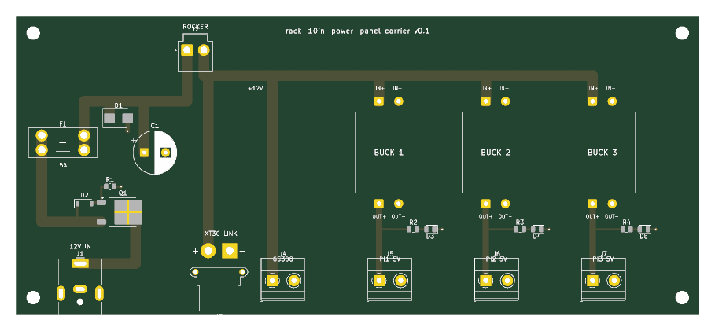

# rack-10in-power-panel

A 3D-printable 1U power panel for a 10" rack. It powers **3× Raspberry Pi 3B+** and a **Netgear GS308** switch from a single 12 V brick. The only mains wiring is the brick's own cord, outside the rack.


## How it works

```
Brick 12V ──► rear DC jack ──► 5A fuse ──► front rocker ──► Wago (+12V / GND)
                                                             ├──► GS308 barrel pigtail (12 V)
                                                             ├──► Buck #1 ──► micro-USB ──► Pi 1
                                                             ├──► Buck #2 ──► micro-USB ──► Pi 2
                                                             └──► Buck #3 ──► micro-USB ──► Pi 3
```

There is one buck converter per Pi, so a fault on one Pi doesn't take down the others.

### Expansion module (Pi 4–6)

A second 1U panel can run off the same brick. Panel 1 taps 12 V after its fuse and rocker and sends it out through an **XT30** pigtail to the expansion panel:

```
Panel 1 Wago ──► 221-413 ──► XT30 link out ──► 18 AWG jumper (<30 cm) ──► XT30 in
                                                                          │
Panel 2: (optional rocker) ──► Wago 221-415 ──► Buck 4–6 ──► Pi 4–6 ◄─────┘
```

- **One 60 W brick handles 6 Pi 3B+ total.** A third panel needs its own brick, or upgrade to a 12 V 7.5 A brick with a 7.5 A fuse.
- The link uses XT30, **not** a 5.5×2.1 barrel. If the brick got plugged into a barrel output by mistake, power would feed in behind the fuse and switch.
- The expansion panel has no fuse of its own: panel 1's 5 A fuse protects the whole chain.
- The GS308 has 7 usable ports, so going past 7 Pis also means adding a second switch.

| Device | Input | Typical draw | Worst case |
|---|---|---|---|
| Pi 3B+ ×3 | 5.1 V micro-USB | ~2–3 W each | ~5–6 W each |
| GS308 | 12 V barrel | ~2–3 W | ~4 W |

## Repo layout

| Path | What |
|---|---|
| [`cad/rack-power-panel.scad`](cad/rack-power-panel.scad) | Parametric OpenSCAD model (panel + tray). Main module by default. |
| [`cad/expansion-panel.scad`](cad/expansion-panel.scad) | Expansion module: includes the main model with `role = "expansion"` |
| [`cad/pcb-panel.scad`](cad/pcb-panel.scad) | Carrier-board module: same panel, tray with 4 standoffs (`role = "pcb"`) |
| [`pcb/`](pcb/) | KiCad carrier board, generated by [`pcb/generate.py`](pcb/generate.py) |
| [`docs/layout.svg`](docs/layout.svg) | Front and top view with dimensions, drawn to scale |
| [`BOM.md`](BOM.md) | Bill of materials |

## Carrier PCB (optional)

A 160 × 70 mm, 2-layer board that replaces the Wago, the inline fuse holder and most of the loose wiring. The buck modules stay off-the-shelf and solder to wire pads, so there's no power-supply design involved.



- **Input:** 5.5×2.1 jack → AOD4185 P-FET for reverse-polarity protection (with a 15 V gate zener) → 5 A mini blade fuse → SMBJ15CA TVS diode + 470 µF bulk capacitor → rocker header (JST-VH; bridge it if you have no rocker).
- **12 V out:** an XT30 link (board-mount female; **pad 2 = +**, matching the AMASS silk) and a screw terminal for the GS308.
- **3 buck slots:** IN+/IN− and OUT+/OUT− wire pads (0.5 mm², fits 20 AWG) around a marked area for the module, a 5 V screw terminal per Pi, and a green status LED.
- **GND** is a full pour on the bottom layer. Power traces on top are 2.5 mm (12 V) and 1.5 mm (5 V). Order 2 oz copper for margin.
- **Expansion board:** the same PCB. Fit J3 (XT30) as the 12 V input and leave out J1, Q1, R1, D2 and F1. Bridge J2 (or fit a rocker); the main panel's fuse protects the link.

Schematic: [`docs/pcb-schematic.pdf`](docs/pcb-schematic.pdf). It's generated, so pins carry net labels rather than drawn wires.

### Regenerating and checking

The schematic, board, project and library tables are all generated from [`pcb/generate.py`](pcb/generate.py). Edit the script, not the `.kicad_*` files, then run:

```bash
pcb/build.sh
```

It regenerates everything, runs **ERC** and **DRC with schematic parity** (the build fails on any error), then exports a schematic PDF, a top-layer SVG, a 3D render, Gerbers and a drill file to `pcb/out/`. It needs KiCad 8 or newer; it was built with 10.0.8.

**Current status:** ERC 0 violations; DRC 0 violations, 0 unconnected, 0 parity issues. Not yet fabricated.

Before ordering, check against real parts:
1. The XT30 polarity marking on your connector.
2. Which side of the screw terminals the wires enter from (meant to face the rear edge).
3. The buck module's footprint against the marked area (about 15 × 19 mm).

## Before printing

The model is parametric. Measure your parts and change the values at the top of the `.scad` file:

1. `ear_pitch` (236.5): your rack's hole spacing, center to center.
2. `buck_in` ([22, 20]): the pocket size for your buck module.
3. `jack_d` (12.2): use 8.2 for an M8-body DC jack.
4. `rocker` ([19.4, 13.1]): the cutout for your rocker switch.
5. `tray_w` (210): this must fit between your rack rails.

To export an STL:

```bash
openscad -o rack-power-panel.stl cad/rack-power-panel.scad
```

```bash
openscad -o expansion-panel.stl cad/expansion-panel.scad
```

Both files share every dimension, so a change in `rack-power-panel.scad` carries over to the expansion panel. To change just the expansion panel, override the parameter in `expansion-panel.scad` below the `include`.

The drawing in `docs/layout.svg` shows the main module before the link-out was added.

| | Main | Expansion |
|---|---|---|
| Input | 5.5×2.1 DC jack (rear wall) | XT30 pigtail through a rear notch |
| Fuse | 5 A inline, with tie-down | none |
| Rocker | yes | optional (`expansion_rocker`) |
| Wago | 221-415 + 221-413 | 221-415 |
| Rear notches | link out, GS308, Pi ×3 | link in, Pi ×3 |
| Strain relief | zip slots at the link-out | zip slots at the link-in |

**Printing:** print with the tray floor on the bed and the front panel standing up, so nothing needs supports. PETG is preferred. If your parts differ from the defaults, print a thin test strip of the front panel first to check the rack holes and the switch cutout.

## Bring-up checklist

1. Power the 12 V bus with nothing connected and check polarity at each Wago output.
2. Measure each buck's output. It should read **5.1–5.2 V**.
3. Check that the GS308 pigtail is **center-positive**.
4. Connect the devices, boot, and run `vcgencmd get_throttled` on each Pi. `0x0` means no under-voltage.

## Status

The model has not been test-printed or checked in OpenSCAD yet. Expect to adjust it after a test print.
